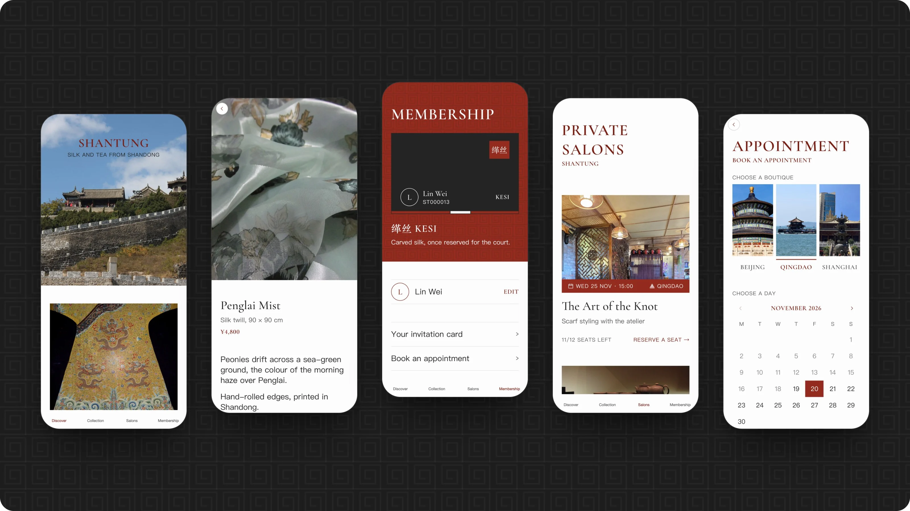
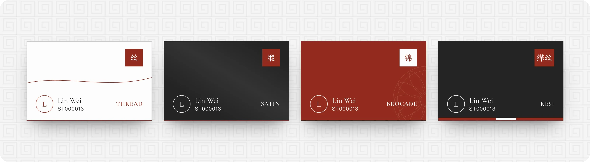
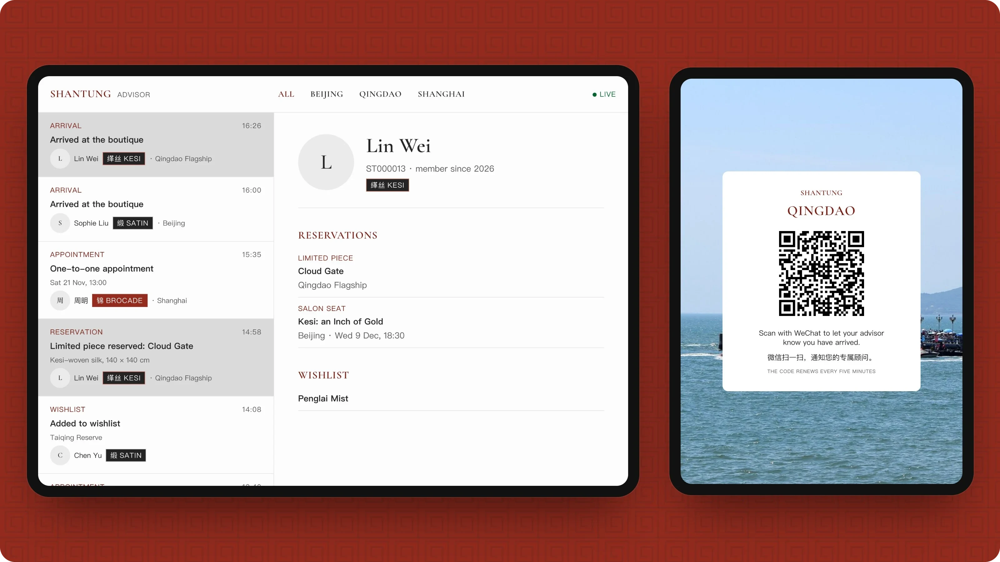

<p align="center">
  
</p>

<p align="center">
  <strong>Luxury clienteling for China: a WeChat Mini Program for clients,<br>iPad screens for advisors, one headless CMS behind both.</strong>
</p>

<p align="center">
  <a href="README.md">English</a> •
  <a href="docs/README.es.md">Español</a> •
  <a href="docs/README.zh.md">简体中文</a> •
  <a href="docs/README.ru.md">Русский</a> •
  <a href="docs/README.fr.md">Français</a>
</p>

<p align="center">
  <a href="https://github.com/pironc/shantung"></a>
  <a href="https://github.com/pironc/shantung/issues"></a>
  <a href="apps/cms"></a>
  <a href="apps/miniprogram"></a>
  <a href="apps/bff"></a>
  <a href="docker-compose.yml"></a>
</p>

<p align="center">
  <a href="#run-it"></a>
  <a href="#run-it"></a>
  <a href="#run-it"></a>
</p>

# Shantung

The client app and boutique tools of **Shantung**, a fictional Shandong maison of silk scarves, ties and Laoshan green tea. A portfolio piece modelled on how agencies build luxury clienteling for China: a headless CMS, a BFF, a WeChat Mini Program and the advisors' iPad screens. Payments are out of scope.

<p align="center">
  
</p>

## Features

### For clients: the WeChat Mini Program

* **Collection:** scarves, ties and tea from a headless Drupal, in English and Simplified Chinese (the phone's language by default). Every screen keeps its last good copy, so a boutique basement with no signal still shows the collection.
* **Membership tiers named after silk:** Thread 丝, Satin 缎, Brocade 锦 and Kesi 缂丝 (by invitation), each with its own card. Members also get an invitation card to save and share with friends; its QR code leads to the maison.
* **Limited releases:** numbered pieces with a priority window per tier. Kesi members reserve first, each lower tier one day later. An atomic Redis counter holds the stock and a PostgreSQL unique index is the last guard, so 50 clients racing for 12 seats get exactly 12.
* **Private salons and appointments:** salon seats by tier, one-to-one appointments with a calendar and a grid of free times, reserve-to-try in a boutique (held 48 hours), and a wishlist.

<p align="center">
  
</p>

### For the boutique: the advisors' iPads

* **Live feed:** each reservation, booking, wishlist and arrival reaches the advisors in real time, through a WeCom-style webhook signed with HMAC-SHA256 (timestamp, nonce, replays refused) and relayed over server-sent events. Tapping a client opens their tier, reservations and wishlist.
* **Entrance kiosk:** a full-screen QR code that changes every five minutes. A client scans it with WeChat, is checked in, and their advisor sees the arrival.

<p align="center">
  
</p>

### Under the hood

* **Drupal 11 as a headless CMS:** the content model lives as YAML in `config/sync`, and JSON:API serves both languages. Editors work in the Drupal back office.
* **A BFF in Fastify:** it shapes the catalog for the apps, caches it in Redis, signs clients in (a mock of the WeChat login), and owns reservations and the feed.
* **One design system for every screen:** tokens in `opendesigner/` feed the Mini Program and the iPads alike: lacquer red, ink and paper, Cormorant Garamond for display, calm motion.

## Run it

```sh
docker compose up --build        # first boot installs Drupal from config and seeds content (about 10 s), later boots take seconds
CMS_PORT=8082 docker compose up  # if 8081 is taken on your machine
docker compose down -v           # start again from nothing
```

| What | URL |
|---|---|
| Mini Program, browser build (open at phone width) | http://localhost:3001 |
| Advisor portal (iPad) | http://localhost:3002 |
| Entrance kiosk (iPad, full screen) | http://localhost:3002/kiosk/QD01 (also `SH01`, `BJ01`) |
| BFF health | http://localhost:3000/health |
| Drupal back office (admin / admin) | http://localhost:8081/user/login |

## Try it

1. Open the Mini Program, go to **Membership** and pick a demo tier (Thread, Satin, Brocade, Kesi): each has its own card.
2. As **Kesi**, open the *Cloud Gate* limited release and reserve it. As **Thread**, the same piece says when your window opens.
3. Keep the **advisor portal** open beside it: the reservation arrives live, and clicking it opens the client's profile.
4. Open a **kiosk** and click its QR code (a phone would scan it): the client is checked in and the portal shows the arrival.
5. Book a **salon** seat or an **appointment**, save a piece to the **wishlist**, and open **Your invitation card** to download it.

## WeChat DevTools

While compose runs, `apps/miniprogram/dist/weapp` is rebuilt on every change. Import that folder in WeChat DevTools with the test AppID; domain checks are already off in `project.config.json`, so requests to `localhost:3000` go through.

## Tests

```sh
docker compose exec bff pnpm --filter bff test   # seat counter under 50 concurrent clients, tier windows, webhook signatures
```

## Where things live

| Path | What |
|---|---|
| `apps/cms` | Drupal 11 on PostgreSQL. The content model is YAML in `config/sync`; change it in the UI, then `docker compose exec cms drush config:export -y` |
| `apps/bff` | Fastify: catalog from JSON:API with a Redis cache, mock WeChat sign-in, reservations, signed WeCom-style feed |
| `apps/miniprogram` | Taro (React), built for WeChat (`dist/weapp`) and the browser |
| `apps/clienteling` | Vite + React: advisor portal and entrance kiosk |
| `packages/shared-types` | Types shared by the BFF and both front ends |
| `DESIGN.md`, `opendesigner/` | The design system. After `engine.py build`, run `pnpm --filter miniprogram tokens` |
| `docs/architecture.md` | How the pieces talk, with sequence diagrams |

## Credits

Every photo is openly licensed; [`apps/cms/seed/photos/CREDITS.md`](apps/cms/seed/photos/CREDITS.md) lists each one with its author and licence. Display type is Cormorant Garamond (SIL Open Font License). Shantung, its pieces and its clients are fictional.
