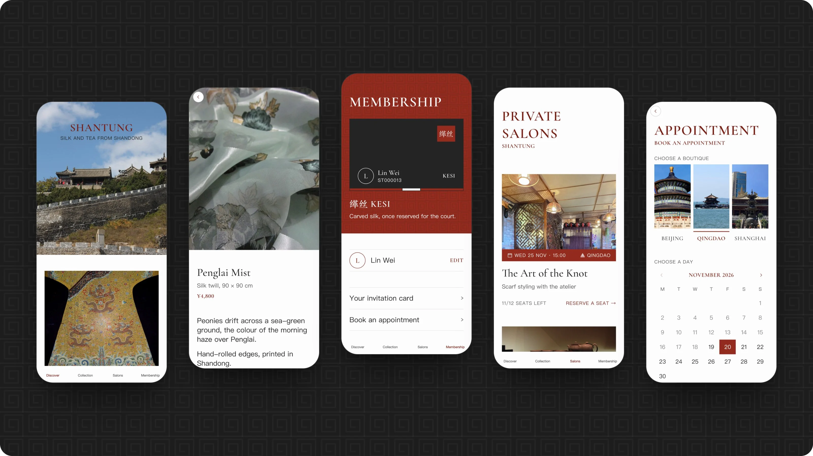
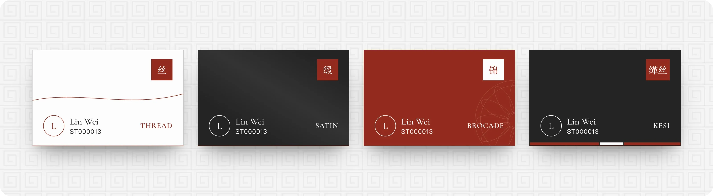
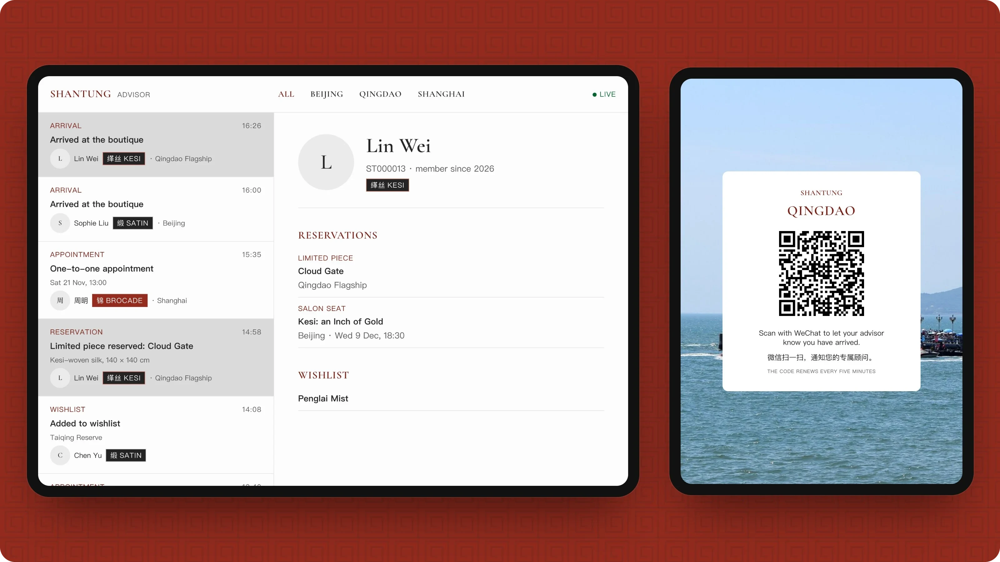

<p align="center">
  
</p>

<p align="center">
  <strong>Clienteling de lujo para China: un Mini Program de WeChat para los clientes, pantallas de iPad para los asesores y un único CMS headless detrás de ambos.</strong>
</p>

<p align="center">
  <a href="../README.md">English</a> •
  <a href="README.es.md">Español</a> •
  <a href="README.zh.md">简体中文</a> •
  <a href="README.ru.md">Русский</a> •
  <a href="README.fr.md">Français</a>
</p>

<p align="center">
  <a href="https://github.com/pironc/shantung"></a>
  <a href="https://github.com/pironc/shantung/issues"></a>
  <a href="../apps/cms"></a>
  <a href="../apps/miniprogram"></a>
  <a href="../apps/bff"></a>
  <a href="../docker-compose.yml"></a>
</p>

<p align="center">
  <a href="#ponerlo-en-marcha"></a>
  <a href="#ponerlo-en-marcha"></a>
  <a href="#ponerlo-en-marcha"></a>
</p>

# Shantung

La app para clientes y las herramientas de boutique de **Shantung**, una maison ficticia de Shandong que vende pañuelos y corbatas de seda y té verde de Laoshan. Un proyecto de portfolio inspirado en cómo las agencias construyen el clienteling de lujo para China: un CMS headless, un BFF, un Mini Program de WeChat y las pantallas de iPad de los asesores. Los pagos quedan fuera del alcance.

<p align="center">
  
</p>

## Funcionalidades

### Para los clientes: el Mini Program de WeChat

* **Colección:** pañuelos, corbatas y té servidos por un Drupal headless, en inglés y en chino simplificado (por defecto, el idioma del teléfono). Cada pantalla guarda su última copia válida, así que en el sótano de una boutique sin cobertura la colección sigue visible.
* **Niveles de membresía con nombres de seda:** Thread 丝, Satin 缎, Brocade 锦 y Kesi 缂丝 (por invitación), cada uno con su propia tarjeta. Los miembros también reciben una tarjeta de invitación para guardar y compartir con sus amigos; su código QR lleva a la maison.
* **Lanzamientos limitados:** piezas numeradas con una ventana prioritaria por nivel. Los miembros Kesi reservan primero; cada nivel inferior, un día después. Un contador atómico en Redis guarda el stock y un índice único de PostgreSQL es la última barrera: 50 clientes que compiten por 12 plazas obtienen exactamente 12.
* **Salones privados y citas:** plazas en salones según el nivel, citas individuales con un calendario y una cuadrícula de horas libres, reserva para probar en boutique (guardada 48 horas) y una lista de deseos.

<p align="center">
  
</p>

### Para la boutique: los iPads de los asesores

* **Feed en directo:** cada reserva, plaza, deseo y llegada llega a los asesores en tiempo real, mediante un webhook al estilo de WeCom firmado con HMAC-SHA256 (marca de tiempo, nonce, repeticiones rechazadas) y retransmitido por server-sent events. Al tocar un cliente se abren su nivel, sus reservas y su lista de deseos.
* **Quiosco de entrada:** un código QR a pantalla completa que cambia cada cinco minutos. El cliente lo escanea con WeChat, queda registrado y su asesor ve la llegada.

<p align="center">
  
</p>

### Por dentro

* **Drupal 11 como CMS headless:** el modelo de contenido vive en YAML dentro de `config/sync` y JSON:API sirve ambos idiomas. Los editores trabajan en el back office de Drupal.
* **Un BFF en Fastify:** adapta el catálogo para las apps, lo guarda en caché en Redis, identifica a los clientes (una simulación del inicio de sesión de WeChat) y gestiona las reservas y el feed.
* **Un único sistema de diseño para todas las pantallas:** los tokens de `opendesigner/` alimentan tanto el Mini Program como los iPads: rojo laca, tinta y papel, Cormorant Garamond para los titulares, movimiento sereno.

## Ponerlo en marcha

```sh
docker compose up --build        # el primer arranque instala Drupal desde la configuración y carga el contenido (unos 10 s); los siguientes tardan segundos
CMS_PORT=8082 docker compose up  # si el puerto 8081 ya está ocupado en tu máquina
docker compose down -v           # volver a empezar desde cero
```

| Qué | URL |
|---|---|
| Mini Program, versión navegador (ábrelo con ancho de teléfono) | http://localhost:3001 |
| Portal del asesor (iPad) | http://localhost:3002 |
| Quiosco de entrada (iPad, pantalla completa) | http://localhost:3002/kiosk/QD01 (también `SH01`, `BJ01`) |
| Estado del BFF | http://localhost:3000/health |
| Back office de Drupal (admin / admin) | http://localhost:8081/user/login |

## Pruébalo

1. Abre el Mini Program, ve a **Membership** y elige un nivel de demostración (Thread, Satin, Brocade, Kesi): cada uno tiene su propia tarjeta.
2. Como **Kesi**, abre el lanzamiento limitado *Cloud Gate, Kesi Edition* y resérvalo. Como **Thread**, la misma pieza indica cuándo se abre tu ventana.
3. Deja el **portal del asesor** abierto al lado: la reserva llega en directo y, al hacer clic, se abre la ficha del cliente.
4. Abre un **quiosco** y haz clic en su código QR (un teléfono lo escanearía): el cliente queda registrado y el portal muestra la llegada.
5. Reserva una plaza en un **salón** o una **cita**, guarda una pieza en la **lista de deseos** y abre **Your invitation card** para descargarla.

## WeChat DevTools

Mientras compose está en marcha, `apps/miniprogram/dist/weapp` se recompila con cada cambio. Importa esa carpeta en WeChat DevTools con el AppID de prueba; la comprobación de dominios ya está desactivada en `project.config.json`, así que las peticiones a `localhost:3000` pasan.

## Tests

```sh
docker compose exec bff pnpm --filter bff test   # contador de plazas con 50 clientes simultáneos, ventanas por nivel, firmas del webhook
```

## Dónde está cada cosa

| Ruta | Qué |
|---|---|
| `apps/cms` | Drupal 11 sobre PostgreSQL. El modelo de contenido es YAML en `config/sync`; cámbialo en la interfaz y luego ejecuta `docker compose exec cms drush config:export -y` |
| `apps/bff` | Fastify: catálogo desde JSON:API con caché en Redis, inicio de sesión de WeChat simulado, reservas, feed firmado al estilo de WeCom |
| `apps/miniprogram` | Taro (React), compilado para WeChat (`dist/weapp`) y para el navegador |
| `apps/clienteling` | Vite + React: portal del asesor y quiosco de entrada |
| `packages/shared-types` | Tipos compartidos por el BFF y los dos front ends |
| `DESIGN.md`, `opendesigner/` | El sistema de diseño. Después de `engine.py build`, ejecuta `pnpm --filter miniprogram tokens` |
| `docs/architecture.md` | Cómo se comunican las piezas, con diagramas de secuencia |

## Créditos

Todas las fotos tienen licencia abierta; [`apps/cms/seed/photos/CREDITS.md`](../apps/cms/seed/photos/CREDITS.md) indica el autor y la licencia de cada una. La tipografía de los titulares es Cormorant Garamond (SIL Open Font License). Shantung, sus piezas y sus clientes son ficticios.
