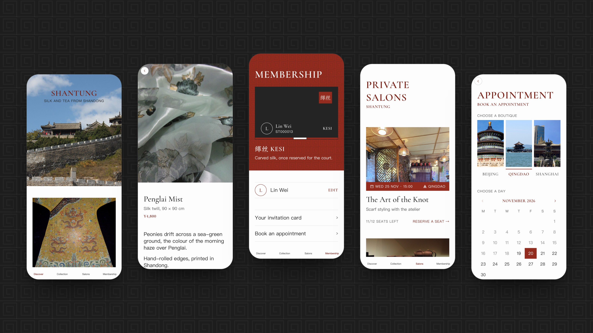
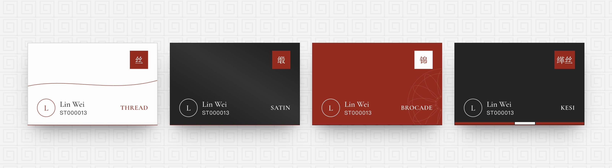
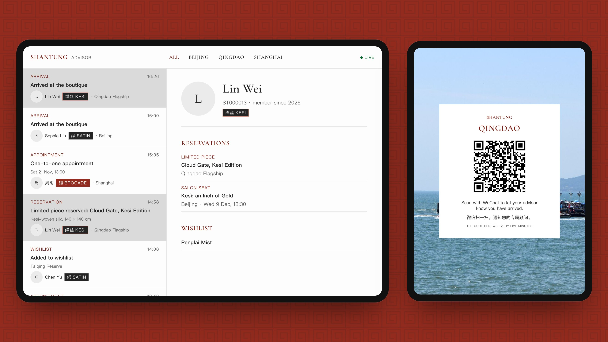

<p align="center">
  
</p>

<p align="center">
  <strong>Le clienteling de luxe pour la Chine : un Mini Program WeChat pour les clients, des écrans iPad pour les conseillers et un seul CMS headless derrière les deux.</strong>
</p>

<p align="center">
  <a href="../README.md">English</a> •
  <a href="README.es.md">Español</a> •
  <a href="README.zh.md">简体中文</a> •
  <a href="README.ru.md">Русский</a> •
  <a href="README.fr.md">Français</a>
</p>

<p align="center">
  <a href="https://github.com/pironc/shantung"></a>
  <a href="https://github.com/pironc/shantung/issues"></a>
  <a href="../apps/cms"></a>
  <a href="../apps/miniprogram"></a>
  <a href="../apps/bff"></a>
  <a href="../docker-compose.yml"></a>
</p>

<p align="center">
  <a href="#lancer-le-projet"></a>
  <a href="#lancer-le-projet"></a>
  <a href="#lancer-le-projet"></a>
</p>

# Shantung

L'application client et les outils de boutique de **Shantung**, une maison fictive du Shandong qui vend des carrés et des cravates en soie ainsi que du thé vert du Laoshan. Un projet de portfolio inspiré de la façon dont les agences construisent le clienteling de luxe pour la Chine : un CMS headless, un BFF, un Mini Program WeChat et les écrans iPad des conseillers. Le paiement n'est pas couvert.

<p align="center">
  
</p>

## Fonctionnalités

### Pour les clients : le Mini Program WeChat

* **Collection :** carrés, cravates et thés servis par un Drupal headless, en anglais et en chinois simplifié (par défaut, la langue du téléphone). Chaque écran garde sa dernière version valide : même au sous-sol d'une boutique sans réseau, la collection reste visible.
* **Des niveaux de membre aux noms de soie :** Thread 丝, Satin 缎, Brocade 锦 et Kesi 缂丝 (sur invitation), chacun avec sa propre carte. Les membres reçoivent aussi une carte d'invitation à enregistrer et à partager avec leurs proches ; son QR code mène à la maison.
* **Éditions limitées :** des pièces numérotées, avec une fenêtre prioritaire par niveau. Les membres Kesi réservent en premier, chaque niveau inférieur un jour plus tard. Un compteur atomique Redis tient le stock et un index unique PostgreSQL sert de dernier garde-fou : 50 clients qui se disputent 12 places en obtiennent exactement 12.
* **Salons privés et rendez-vous :** des places en salon selon le niveau, des rendez-vous individuels avec un calendrier et une grille des horaires libres, la réservation pour essayer en boutique (gardée 48 heures) et une liste d'envies.

<p align="center">
  
</p>

### Pour la boutique : les iPad des conseillers

* **Fil en direct :** chaque réservation, inscription, envie et arrivée parvient aux conseillers en temps réel, par un webhook façon WeCom signé en HMAC-SHA256 (horodatage, nonce, rejeux refusés) puis relayé en server-sent events. Toucher un client ouvre son niveau, ses réservations et sa liste d'envies.
* **Borne d'accueil :** un QR code plein écran qui change toutes les cinq minutes. Le client le scanne avec WeChat, son arrivée est enregistrée et son conseiller la voit.

<p align="center">
  
</p>

### Sous le capot

* **Drupal 11 en CMS headless :** le modèle de contenu vit en YAML dans `config/sync` et JSON:API sert les deux langues. Les éditeurs travaillent dans le back-office Drupal.
* **Un BFF en Fastify :** il prépare le catalogue pour les applications, le met en cache dans Redis, identifie les clients (une simulation de la connexion WeChat) et gère les réservations et le fil.
* **Un seul design system pour tous les écrans :** les tokens de `opendesigner/` alimentent le Mini Program comme les iPad : rouge laque, encre et papier, Cormorant Garamond pour les titres, des animations calmes.

## Lancer le projet

```sh
docker compose up --build        # le premier démarrage installe Drupal depuis la configuration et charge le contenu (environ 10 s) ; les suivants prennent quelques secondes
CMS_PORT=8082 docker compose up  # si le port 8081 est déjà pris sur votre machine
docker compose down -v           # repartir de zéro
```

| Quoi | URL |
|---|---|
| Mini Program, version navigateur (à ouvrir en largeur de téléphone) | http://localhost:3001 |
| Portail du conseiller (iPad) | http://localhost:3002 |
| Borne d'accueil (iPad, plein écran) | http://localhost:3002/kiosk/QD01 (aussi `SH01`, `BJ01`) |
| État du BFF | http://localhost:3000/health |
| Back-office Drupal (admin / admin) | http://localhost:8081/user/login |

## Essayer

1. Ouvrez le Mini Program, allez dans **Membership** et choisissez un niveau de démonstration (Thread, Satin, Brocade, Kesi) : chacun a sa propre carte.
2. En **Kesi**, ouvrez l'édition limitée *Cloud Gate, Kesi Edition* et réservez-la. En **Thread**, la même pièce indique quand votre fenêtre ouvre.
3. Gardez le **portail du conseiller** ouvert à côté : la réservation arrive en direct, et un clic ouvre la fiche du client.
4. Ouvrez une **borne** et cliquez sur son QR code (un téléphone le scannerait) : l'arrivée du client est enregistrée et le portail l'affiche.
5. Réservez une place en **salon** ou un **rendez-vous**, ajoutez une pièce à la **liste d'envies** et ouvrez **Your invitation card** pour la télécharger.

## WeChat DevTools

Tant que compose tourne, `apps/miniprogram/dist/weapp` est reconstruit à chaque modification. Importez ce dossier dans WeChat DevTools avec l'AppID de test ; la vérification des domaines est déjà désactivée dans `project.config.json`, donc les requêtes vers `localhost:3000` passent.

## Tests

```sh
docker compose exec bff pnpm --filter bff test   # compteur de places avec 50 clients simultanés, fenêtres par niveau, signatures du webhook
```

## Où trouver quoi

| Chemin | Quoi |
|---|---|
| `apps/cms` | Drupal 11 sur PostgreSQL. Le modèle de contenu est en YAML dans `config/sync` ; modifiez-le dans l'interface, puis lancez `docker compose exec cms drush config:export -y` |
| `apps/bff` | Fastify : catalogue issu de JSON:API avec cache Redis, connexion WeChat simulée, réservations, fil signé façon WeCom |
| `apps/miniprogram` | Taro (React), compilé pour WeChat (`dist/weapp`) et pour le navigateur |
| `apps/clienteling` | Vite + React : portail du conseiller et borne d'accueil |
| `packages/shared-types` | Les types partagés par le BFF et les deux front-ends |
| `DESIGN.md`, `opendesigner/` | Le design system. Après `engine.py build`, lancez `pnpm --filter miniprogram tokens` |
| `docs/architecture.md` | Comment les briques communiquent, avec des diagrammes de séquence |

## Crédits

Toutes les photos sont sous licence libre ; [`apps/cms/seed/photos/CREDITS.md`](../apps/cms/seed/photos/CREDITS.md) indique l'auteur et la licence de chacune. Les titres sont composés en Cormorant Garamond (SIL Open Font License). Shantung, ses pièces et ses clients sont fictifs.
