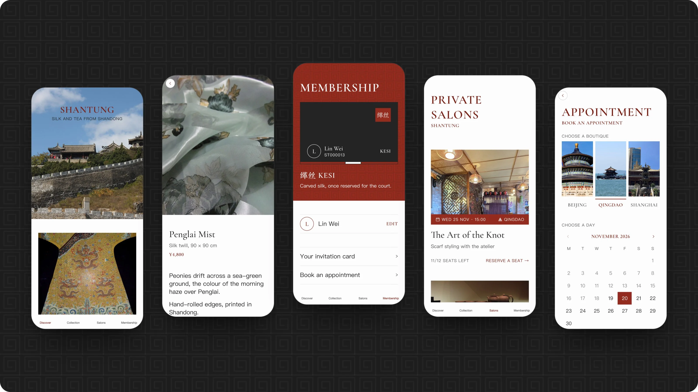
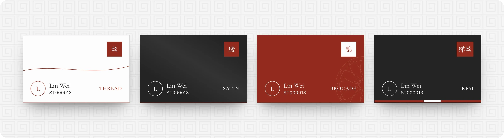
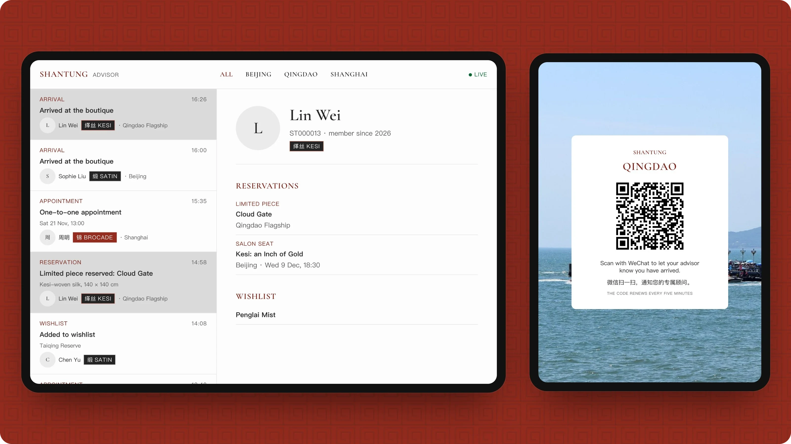

<p align="center">
  
</p>

<p align="center">
  <strong>Люксовый клиентинг для Китая: мини-программа WeChat для клиентов,<br>экраны iPad для консультантов бутика и одна headless CMS за ними.</strong>
</p>

<p align="center">
  <a href="../README.md">English</a> •
  <a href="README.es.md">Español</a> •
  <a href="README.zh.md">简体中文</a> •
  <a href="README.ru.md">Русский</a> •
  <a href="README.fr.md">Français</a>
</p>

<p align="center">
  <a href="https://github.com/pironc/shantung"></a>
  <a href="https://github.com/pironc/shantung/issues"></a>
  <a href="../apps/cms"></a>
  <a href="../apps/miniprogram"></a>
  <a href="../apps/bff"></a>
  <a href="../docker-compose.yml"></a>
</p>

<p align="center">
  <a href="#запуск"></a>
  <a href="#запуск"></a>
  <a href="#запуск"></a>
</p>

# Shantung

Клиентское приложение и инструменты бутика **Shantung** — вымышленного дома из провинции Шаньдун, который продаёт шёлковые платки, галстуки и зелёный чай лаошань. Проект для портфолио, построенный так, как агентства создают люксовый клиентинг для Китая: headless CMS, BFF, мини-программа WeChat и экраны iPad для консультантов. Платежи в проект не входят.

<p align="center">
  
</p>

## Возможности

### Для клиентов: мини-программа WeChat

* **Коллекция:** платки, галстуки и чай из headless Drupal, на английском и упрощённом китайском (по умолчанию — язык телефона). Каждый экран хранит последнюю удачно загруженную версию, поэтому даже в подвале бутика без связи коллекцию видно.
* **Уровни участия, названные в честь шёлка:** Thread 丝, Satin 缎, Brocade 锦 и Kesi 缂丝 (только по приглашению), у каждого своя карта. Участники также получают пригласительную карту, которую можно сохранить и отправить друзьям; её QR-код ведёт к дому.
* **Лимитированные выпуски:** пронумерованные изделия с приоритетным окном для каждого уровня. Участники Kesi бронируют первыми, каждый следующий уровень — на день позже. Остаток хранит атомарный счётчик в Redis, а уникальный индекс PostgreSQL служит последней защитой: из 50 клиентов, одновременно претендующих на 12 мест, места получают ровно 12.
* **Закрытые салоны и встречи:** места в салонах по уровню, индивидуальные встречи с календарём и сеткой свободного времени, бронь на примерку в бутике (держится 48 часов) и список желаний.

<p align="center">
  
</p>

### Для бутика: iPad консультантов

* **Лента в реальном времени:** каждая бронь, запись, добавление в список желаний и визит сразу доходят до консультантов через вебхук в стиле WeCom, подписанный HMAC-SHA256 (метка времени, nonce, повторы отклоняются), и транслируются через server-sent events. Нажатие на клиента открывает его уровень, брони и список желаний.
* **Терминал на входе:** полноэкранный QR-код, который меняется каждые пять минут. Клиент сканирует его в WeChat, отмечается, и его консультант видит визит.

<p align="center">
  
</p>

### Под капотом

* **Drupal 11 как headless CMS:** модель контента хранится в YAML в `config/sync`, а JSON:API отдаёт оба языка. Редакторы работают в админке Drupal.
* **BFF на Fastify:** готовит каталог для приложений, кеширует его в Redis, авторизует клиентов (имитация входа через WeChat) и ведёт брони и ленту.
* **Одна дизайн-система для всех экранов:** токены из `opendesigner/` питают и мини-программу, и iPad: лаковый красный, тушь и бумага, Cormorant Garamond для заголовков, спокойная анимация.

## Запуск

```sh
docker compose up --build        # первый запуск устанавливает Drupal из конфигурации и загружает контент (около 10 с), следующие занимают секунды
CMS_PORT=8082 docker compose up  # если порт 8081 на вашей машине занят
docker compose down -v           # начать с нуля
```

| Что | URL |
|---|---|
| Мини-программа, версия для браузера (открывайте в ширину телефона) | http://localhost:3001 |
| Портал консультанта (iPad) | http://localhost:3002 |
| Терминал на входе (iPad, полный экран) | http://localhost:3002/kiosk/QD01 (а также `SH01`, `BJ01`) |
| Состояние BFF | http://localhost:3000/health |
| Админка Drupal (admin / admin) | http://localhost:8081/user/login |

## Попробуйте

1. Откройте мини-программу, перейдите в **Membership** и выберите демо-уровень (Thread, Satin, Brocade, Kesi): у каждого своя карта.
2. Как **Kesi** откройте лимитированный выпуск *Cloud Gate* и забронируйте его. Как **Thread** то же изделие покажет, когда откроется ваше окно.
3. Держите рядом открытым **портал консультанта**: бронь появляется сразу, а по клику открывается профиль клиента.
4. Откройте **терминал** и нажмите на его QR-код (телефон бы его отсканировал): клиент отмечен, а портал показывает визит.
5. Забронируйте место в **салоне** или **встречу**, добавьте изделие в **список желаний** и откройте **Your invitation card**, чтобы скачать её.

## WeChat DevTools

Пока работает compose, `apps/miniprogram/dist/weapp` пересобирается при каждом изменении. Импортируйте эту папку в WeChat DevTools с тестовым AppID; проверка доменов уже отключена в `project.config.json`, поэтому запросы к `localhost:3000` проходят.

## Тесты

```sh
docker compose exec bff pnpm --filter bff test   # счётчик мест при 50 одновременных клиентах, окна уровней, подписи вебхука
```

## Что где лежит

| Путь | Что |
|---|---|
| `apps/cms` | Drupal 11 на PostgreSQL. Модель контента — YAML в `config/sync`; измените её в интерфейсе, затем выполните `docker compose exec cms drush config:export -y` |
| `apps/bff` | Fastify: каталог из JSON:API с кешем в Redis, имитация входа через WeChat, брони, подписанная лента в стиле WeCom |
| `apps/miniprogram` | Taro (React), сборка для WeChat (`dist/weapp`) и для браузера |
| `apps/clienteling` | Vite + React: портал консультанта и терминал на входе |
| `packages/shared-types` | Типы, общие для BFF и обоих фронтендов |
| `DESIGN.md`, `opendesigner/` | Дизайн-система. После `engine.py build` выполните `pnpm --filter miniprogram tokens` |
| `docs/architecture.md` | Как взаимодействуют части системы, с диаграммами последовательностей |

## Благодарности

Все фотографии распространяются по открытым лицензиям; в [`apps/cms/seed/photos/CREDITS.md`](../apps/cms/seed/photos/CREDITS.md) для каждой указаны автор и лицензия. Шрифт заголовков — Cormorant Garamond (SIL Open Font License). Shantung, его изделия и клиенты вымышлены.
