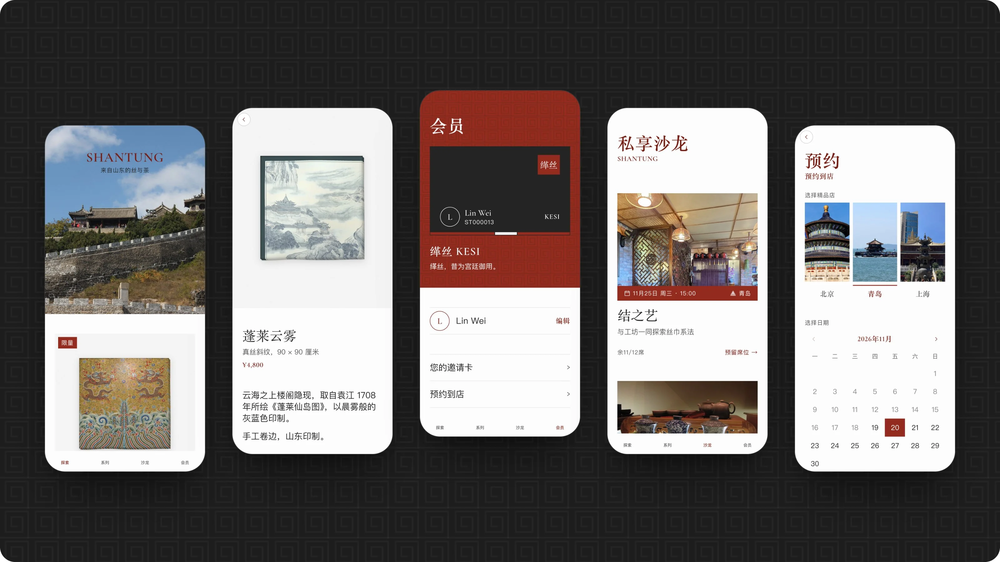
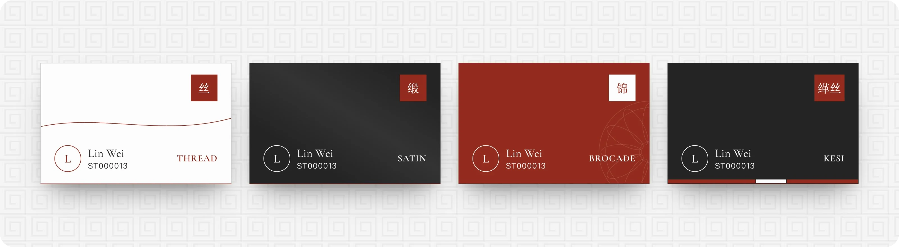
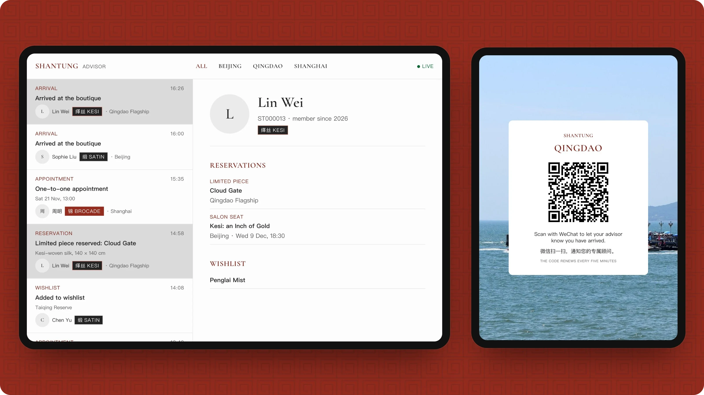

<p align="center">
  
</p>

<p align="center">
  <strong>面向中国市场的奢侈品客户经营：为客户打造的微信小程序，<br>为精品店顾问准备的 iPad 屏幕，背后是同一个无头 CMS。</strong>
</p>

<p align="center">
  <a href="../README.md">English</a> •
  <a href="README.es.md">Español</a> •
  <a href="README.zh.md">简体中文</a> •
  <a href="README.ru.md">Русский</a> •
  <a href="README.fr.md">Français</a>
</p>

<p align="center">
  <a href="https://github.com/pironc/shantung"></a>
  <a href="https://github.com/pironc/shantung/issues"></a>
  <a href="../apps/cms"></a>
  <a href="../apps/miniprogram"></a>
  <a href="../apps/bff"></a>
  <a href="../docker-compose.yml"></a>
</p>

<p align="center">
  <a href="#运行"></a>
  <a href="#运行"></a>
  <a href="#运行"></a>
</p>

# Shantung

**Shantung** 的客户应用与精品店工具。Shantung 是一家虚构的山东品牌，经营丝巾、领带与崂山绿茶。这是一个作品集项目，参照了代理公司为中国市场打造奢侈品客户经营（clienteling）的方式：一个无头 CMS、一个 BFF、一个微信小程序，以及顾问使用的 iPad 屏幕。支付不在本项目范围内。

<p align="center">
  
</p>

## 功能特性

### 面向客户：微信小程序

* **系列：** 丝巾、领带与茶叶的内容来自无头 Drupal，支持英文与简体中文（默认跟随手机语言）。每个页面都会保存最近一次成功加载的内容，即使在信号不佳的精品店地下层也能浏览系列。
* **以丝绸命名的会员等级：** 丝 Thread、缎 Satin、锦 Brocade 与缂丝 Kesi（仅限受邀），每个等级都有专属会员卡。会员还会获得一张邀请卡，可保存并分享给好友，扫描卡上的二维码即可了解本坊。
* **限量发售：** 逐一编号的作品，每个等级都有优先预留通道。缂丝会员最先预留，此后每低一级晚一日开放。库存由 Redis 原子计数器管理，PostgreSQL 唯一索引作为最后一道保障：50 位客户同时抢 12 个席位，恰好 12 位成功。
* **私享沙龙与预约：** 按等级预留沙龙席位；一对一到店预约，配有日历与可选时段；预约到店试戴（保留 48 小时）；以及心愿单。

<p align="center">
  
</p>

### 面向精品店：顾问的 iPad

* **实时动态：** 每一次预留、订座、加入心愿单与到店，都会实时推送给顾问。消息经由仿企业微信的 webhook 传递，使用 HMAC-SHA256 签名（时间戳、随机数，拒绝重放），再通过 server-sent events 转发。点击客户即可查看其等级、预留与心愿单。
* **入口签到屏：** 全屏二维码每五分钟更新一次。客户用微信扫码即完成签到，专属顾问随即看到到店提醒。

<p align="center">
  
</p>

### 技术实现

* **Drupal 11 作为无头 CMS：** 内容模型以 YAML 形式保存在 `config/sync` 中，JSON:API 同时提供两种语言。编辑在 Drupal 后台工作。
* **基于 Fastify 的 BFF：** 为各应用整理商品目录并缓存在 Redis 中，负责客户登录（模拟微信登录），并管理预留与实时动态。
* **所有屏幕共用一套设计系统：** `opendesigner/` 中的设计令牌同时驱动小程序与 iPad：漆红、墨色与纸白，标题使用 Cormorant Garamond，动效沉静克制。

## 运行

```sh
docker compose up --build        # 首次启动会根据配置安装 Drupal 并导入内容（约 10 秒），之后启动只需几秒
CMS_PORT=8082 docker compose up  # 如果本机 8081 端口已被占用
docker compose down -v           # 从零开始
```

| 内容 | 地址 |
|---|---|
| 小程序浏览器版（请以手机宽度打开） | http://localhost:3001 |
| 顾问门户（iPad） | http://localhost:3002 |
| 入口签到屏（iPad，全屏） | <http://localhost:3002/kiosk/QD01>（另有 `SH01`、`BJ01`） |
| BFF 健康检查 | http://localhost:3000/health |
| Drupal 后台（admin / admin） | http://localhost:8081/user/login |

## 体验一下

1. 打开小程序，进入 **会员**，选择一个演示等级（丝、缎、锦、缂丝）：每个等级都有专属会员卡。
2. 以 **缂丝** 身份打开限量作品「云门」并预留。以 **丝** 身份查看同一件作品，会显示您的预留通道何时开放。
3. 在旁边打开 **顾问门户**：预留会实时出现，点击即可打开客户档案。
4. 打开一个 **签到屏** 并点击二维码（手机则直接扫码）：客户完成签到，门户显示到店提醒。
5. 预留一个 **沙龙** 席位或一次 **预约**，把作品 **加入心愿单**，再打开 **您的邀请卡** 下载图片。

## 微信开发者工具

compose 运行期间，`apps/miniprogram/dist/weapp` 会随每次修改重新构建。用测试 AppID 将该文件夹导入微信开发者工具即可；`project.config.json` 已关闭域名校验，因此对 `localhost:3000` 的请求可以正常通过。

## 测试

```sh
docker compose exec bff pnpm --filter bff test   # 50 位客户并发下的席位计数、等级通道、webhook 签名
```

## 目录结构

| 路径 | 内容 |
|---|---|
| `apps/cms` | 基于 PostgreSQL 的 Drupal 11。内容模型以 YAML 保存在 `config/sync`；在界面中修改后，运行 `docker compose exec cms drush config:export -y` |
| `apps/bff` | Fastify：来自 JSON:API 并经 Redis 缓存的商品目录、模拟微信登录、预留、签名的仿企业微信动态 |
| `apps/miniprogram` | Taro（React），构建为微信小程序（`dist/weapp`）与浏览器版 |
| `apps/clienteling` | Vite + React：顾问门户与入口签到屏 |
| `packages/shared-types` | BFF 与两个前端共用的类型 |
| `DESIGN.md`、`opendesigner/` | 设计系统。运行 `engine.py build` 后，再运行 `pnpm --filter miniprogram tokens` |
| `docs/architecture.md` | 各部分如何通信，附时序图 |

## 致谢

所有照片均采用开放许可；[`apps/cms/seed/photos/CREDITS.md`](../apps/cms/seed/photos/CREDITS.md) 列出了每张照片的作者与许可。商品图由这些照片制作，茶叶罐则以代码绘制，脚本见 [`apps/cms/seed/packshots`](../apps/cms/seed/packshots)。标题字体为 Cormorant Garamond（SIL Open Font License）。Shantung、其作品与客户均为虚构。
