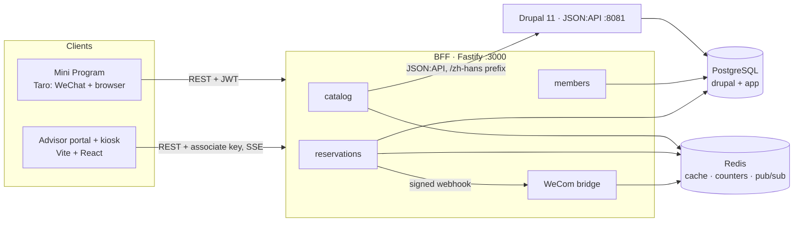
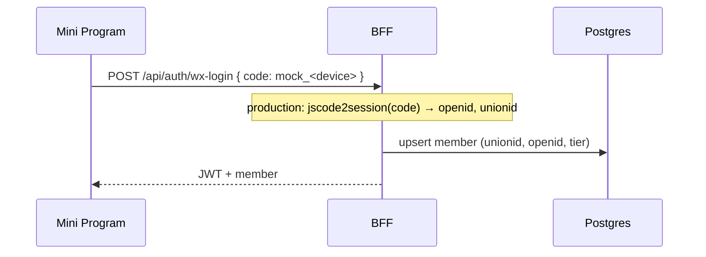
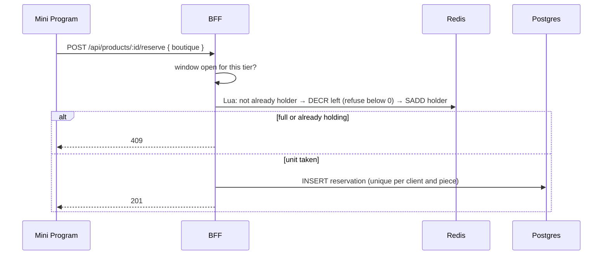
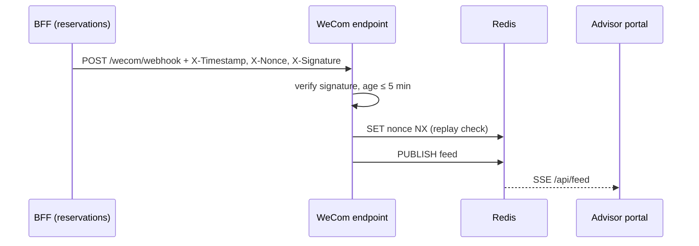
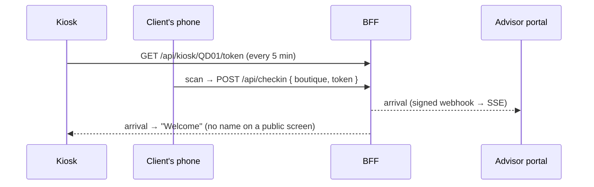

# Architecture

## Sign-in

A real Mini Program sends the code from `wx.login()`; the BFF exchanges it with WeChat (`jscode2session`, with the AppSecret that never leaves the server) for an OpenID (this app) and a UnionID (every app of the brand). Without a registered AppID, the client sends `mock_<device id>` and both IDs are derived from it.

## A limited release

Each tier opens a day apart (Kesi first). The seat or piece is taken atomically in Redis, then written to Postgres, whose unique index is the final word; if the write fails, the unit goes back.

## Telling the boutique

Every reservation, booking, appointment, wishlist addition and arrival becomes a WeCom-style markdown card, signed with HMAC-SHA256 over timestamp, nonce and body. The simulated WeCom endpoint verifies it, refuses anything older than five minutes or replayed, stores it and publishes it; advisor screens receive it over Server-Sent Events. In production `WECOM_URL` would point at WeCom.

## Kiosk check-in

The entrance screen shows a QR code holding the boutique code and a token that changes every five minutes, so a photo of it cannot check anyone in later. In WeChat it would be a Mini Program code carrying the same two values.

## Decisions

| Decision | Why |
|---|---|
| One pnpm workspace, no Turborepo | Five packages; shared types need no build step |
| Drupal structure in `config/sync` | Reviewable YAML; a fresh install rebuilds the same site in seconds |
| Redis counter, not a lock | A lock queues requests; a counter guarantees nothing is promised twice |
| HMAC only between servers | A secret in an app bundle can be extracted |
| Server-Sent Events | One-way feed; native `EventSource` reconnects by itself |
| Fastify | Four route groups; no dependency-injection framework needed |
| Tokens scoped to `.ds` for WeChat | WXSS rejects `:root` and attribute selectors; `scripts/tokens.mjs` generates the file |
| Invitation card in a subpackage | Canvas drawing and the QR library stay out of the 2 MB main package |
